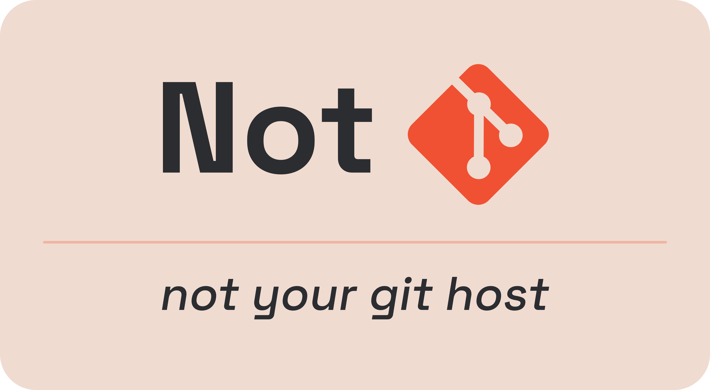

<p align="center"></p>

# NotGit

NotGit is a simple git client rebuilt using C++23. The goal of this project is to learn more about git internals and to have fun doing it. It is not meant to be a replacement for git, but rather a learning tool.

## Local development

- Clone the repository and navigate to it:

```bash
git clone https://github.com/thejus03/NotGit.git
cd NotGit
```

- Install the build system (ninja)

```bash
brew install ninja
```

- Run this **once** to generate the Ninja build file:

```bash
cmake -B build -G Ninja
```

- Now you can just run this for building source code

```bash
cmake --build build
```
